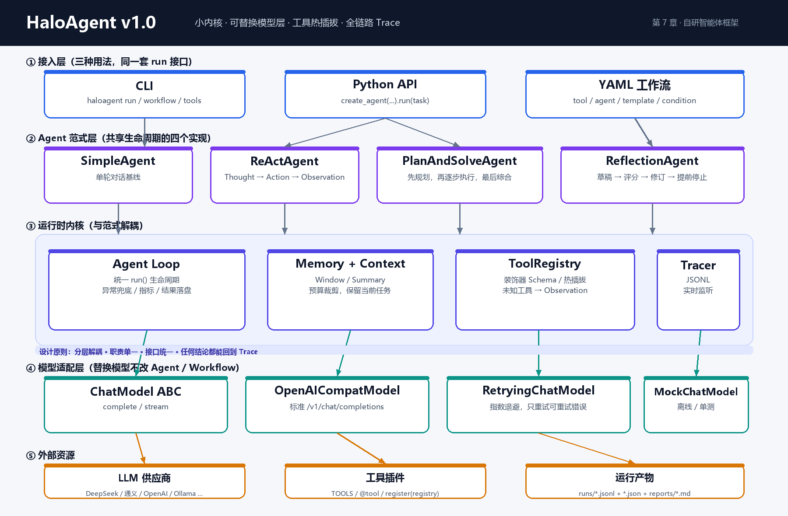

# HaloAgent v1.0

> 一个跟着《Hello-Agents》第 1–7 章从零写出来的智能体框架：**小内核、可替换模型层、工具热插拔、全链路 Trace**。
>
> 第 4 周阶段产物：自研智能体框架 v1.0（代码仓库 + 架构图 + 单元测试 + 端到端演示），
> 把前三周的三范式、低代码工作流与可替换 Model Layer 迁到同一框架上运行。
>
> 仓库：**https://github.com/xiaolu-coding/haloagent-v1**



---

## 0. 30 秒跑起来（不需要 API Key）

```powershell
cd E:\helloAgents学习\haloagent-v1
$env:PYTHONPATH="$PWD\src"

python -m pytest                             # 22 个单元测试
python demo/compare_paradigms.py             # 三范式同一任务对比
python demo/hotplug_demo.py                  # 工具热插拔
python -m haloagent workflow examples/workflows/travel_brief.yaml --config configs/mock.yaml
```

演示使用 `MockChatModel`：它不是"假 Agent"，而是把模型输出换成可重复的脚本，
Agent 循环、工具调用、Memory、Trace、报告全部走真实代码路径。

### 接真实模型

```powershell
Copy-Item .env.example .env
# 在 .env 里填 DEEPSEEK_API_KEY / DASHSCOPE_API_KEY / OPENAI_API_KEY 之一
python -m haloagent doctor --config configs/default.yaml
python -m haloagent run "帮我算 (3*5)+(2*38)，并解释每一步" --config configs/default.yaml
python demo/compare_paradigms.py --real --config configs/default.yaml
```

任何 OpenAI 兼容端点都可以：

```dotenv
LLM_API_KEY=sk-xxx
LLM_BASE_URL=https://api.deepseek.com/v1
LLM_MODEL_ID=deepseek-chat
```

---

## 1. 交付物对照（对着第 4 周要求逐条验收）

| 第 4 周要求 | 本项目落点 | 证据 |
|---|---|---|
| 自研智能体框架 v1.0 | `src/haloagent/`，7 个模块、约 3.8k 行 | `README` / `docs/ARCHITECTURE.md` |
| 模型层 Model Layer | `ChatModel` 抽象 + `OpenAICompatModel` + `MockChatModel` + `RetryingChatModel` | `models/`、`test_models.py` |
| Tool/Skill 注册与调度 | `@tool` 自动 Schema、`ToolRegistry`、插件热加载/卸载 | `tools/`、`test_tools.py` |
| Agent 主循环 | `BaseAgent.run()` 统一生命周期；ReAct 的 Thought-Action-Observation | `agents/base.py`、`agents/react.py` |
| Memory & Context 管理 | `WindowMemory` / `SummaryMemory` / `ContextBuilder` 预算裁剪 | `memory/`、`test_memory.py` |
| 异常重试与流式输出 | 只重试可重试错误；`ChatModel.stream()` + CLI `stream` | `models/retry.py`、`demo/stream_demo.py` |
| 统一入口 `run(task)` | `agent.run(task) -> RunResult`；三种范式签名一致 | 所有 `agents/*.py` |
| YAML/JSON 配置 | `configs/default.yaml`、`configs/mock.yaml`、`${ENV}` 展开 | `core/config.py` |
| 插件式工具热插拔 | `load_plugin` / `unload_plugin` / entry points | `tools/registry.py`、`demo/hotplug_demo.py` |
| 回调 Trace 替代黑盒 | `Tracer` 事件流 + JSONL + 实时 listener | `trace/`、`runs/*.jsonl` |
| 三范式迁移 | ReAct / Plan-and-Solve / Reflection 全部基于 `BaseAgent` | `agents/`、`reports/paradigm_comparison_mock.md` |
| 低代码工作流迁移 | YAML DSL：tool / agent / template / condition / output + DAG | `workflow/engine.py`、`examples/workflows/` |
| 框架 API 设计文档 | `docs/API.md` | API + 配置 + Trace 事件表 |
| 同框架轨迹对比报告 | `reports/paradigm_comparison_mock.md` | 实际运行生成 |
| 单元测试 | `tests/` 22 个用例 | `reports/pytest.txt` |
| 端到端演示 | CLI、三范式对比、工作流、热插拔、流式 | `demo/` |

---

## 2. 为什么是这 7 个模块

第 7 章把主流框架的痛点总结为：**过度抽象的复杂性、快速迭代的不稳定性、黑盒化的实现逻辑、依赖复杂**。
HaloAgent 的回应不是"再包一层"，而是把内核压到 7 个概念：

```text
接入层     CLI / Python API / YAML Workflow
范式层     Simple / ReAct / Plan-and-Solve / Reflection
运行时     BaseAgent Loop + Memory/Context + ToolRegistry + Tracer
适配层     ChatModel ABC -> OpenAICompat / Mock / Retrying
```

- **只有 `BaseAgent` 是"特殊"的**，其余能力尽量收敛为工具与可替换组件；
- 模型调用、工具执行、上下文裁剪、Trace 都在 `BaseAgent` 的统一生命周期里，范式只写"怎么想"；
- 不为每家厂商写 SDK，统一走 OpenAI 兼容协议；
- 所有关键动作都发 Trace 事件，"为什么这么答"可以逐帧回放。

---

## 3. 最小 API

```python
from haloagent import ReActAgent, MockChatModel, default_registry, AgentConfig

agent = ReActAgent(
    "Halo",
    MockChatModel("Final Answer: 你好，我是 Halo。"),
    default_registry(["calculator"]),
    config=AgentConfig(max_steps=6),
)
result = agent.run("1+1 等于几？")

print(result.status)          # success
print(result.answer)          # 最终答案
print(result.metrics.to_dict())
print(result.trace_path)      # runs/react-xxxx.jsonl
print(result.metadata)        # 计划 / 反思 / 上下文统计 / 工具使用
```

真实模型：

```python
from haloagent import create_model, create_agent, load_config, build_tools

config = load_config("configs/default.yaml")
llm = create_model(config.llm)
agent = create_agent(
    "Halo", llm, build_tools(config.tools, config.plugins),
    paradigm="react", config=config.agent,
    memory_config=config.memory, trace_config=config.trace,
)
print(agent.run("...").answer)
```

---

## 4. 工具：从函数到可热插拔插件

```python
from haloagent import tool

@tool(name="weather", description="查询城市天气")
def weather(city: str) -> str:
    """查询天气。

    Args:
        city: 城市名，例如 北京
    """
    return f"{city}：晴，18°C"

# 函数仍可直接调用；同时附带 JSON Schema
print(weather("北京"))
print(weather.__halo_tool__.to_openai_schema())
```

插件文件只需暴露 `TOOLS`、任意 `@tool` 函数、或 `register(registry)`：

```python
# examples/plugins/weather_fixture.py
TOOLS = [weather.__halo_tool__]
```

```python
registry.load_plugin("examples/plugins/weather_fixture.py")
registry.execute("weather", {"city": "北京"})
registry.unload_plugin("E:/.../weather_fixture.py")   # 立刻从 Agent 可用工具中消失
```

---

## 5. 低代码工作流

`examples/workflows/travel_brief.yaml`：

```yaml
name: 周末出行简报
inputs:
  city: 北京
nodes:
  - id: weather
    type: tool
    tool: weather
    args: { city: ${inputs.city} }
  - id: rainy
    type: condition
    if: contains(${nodes.weather.output}, '雨')
  - id: umbrella
    type: template
    when: ${nodes.rainy.output}
    template: 提醒：${inputs.city}有雨，记得带伞。
  - id: brief
    type: agent
    paradigm: react
    task: |
      根据天气 ${nodes.weather.output} 和提醒 ${nodes.umbrella.output} 写一份出行简报。
  - id: result
    type: output
    value: ${nodes.brief.output}
```

```powershell
python -m haloagent workflow examples/workflows/travel_brief.yaml --config configs/mock.yaml
```

执行器负责：拓扑排序、环检测、变量替换、条件跳过、Agent/工具调度、节点级 Trace。
这就是第 5 章"低代码平台节点编排"在自研框架里的最小实现。

---

## 6. 三种范式：同一条 Trace，不同的思考路径

同一道题、同一套工具，实际运行结果（Mock 模式，验证链路）：

| 范式 | LLM 调用 | 工具调用 | 步数 | 总 Tokens | 特点 |
|---|---:|---:|---:|---:|---|
| ReAct | 3 | 2 | 3 | 1666 | 边想边做，路径最短 |
| Plan-and-Solve | 7 | 2 | 3 | 2753 | 计划显式，步骤可审计 |
| Reflection | 6 | 2 | 5 | 2720 | 自评 + 修订，答案更完整 |

完整报告：[`reports/paradigm_comparison_mock.md`](reports/paradigm_comparison_mock.md)

> 真实模型的数字会不同；报告里明确标注了"Mock 模式不代表回答质量"。

---

## 7. Trace：黑盒变白盒

每次运行默认写两个文件：

- `runs/<run_id>.jsonl`：逐事件轨迹；
- `runs/<run_id>.json`：`RunResult` 汇总。

事件类型：

```text
run_start -> context -> llm_request -> llm_response
          -> thought -> action -> tool_result -> observation
          -> plan / step_result / reflection / revision
          -> final -> run_end
```

```powershell
Get-Content runs\react-*.jsonl -TotalCount 5
```

Trace 默认对 `api_key` / `authorization` / `token` 等字段做脱敏；
可通过 `TraceConfig(redact=False)` 关闭。

---

## 8. 目录结构

```text
haloagent-v1/
├── src/haloagent/
│   ├── core/          # Message / Config / Types / Errors / Token 估算
│   ├── models/        # ChatModel / OpenAI 兼容 / Mock / 重试 / 路由
│   ├── tools/         # ToolSpec / 装饰器 / Registry / 插件 / 内置工具
│   ├── memory/        # Window / Summary / ContextBuilder / JSON 持久化
│   ├── trace/         # Tracer / TraceEvent / JSONL
│   ├── agents/        # Base / Simple / ReAct / PlanAndSolve / Reflection
│   ├── workflow/      # YAML 低代码 DAG 引擎
│   └── cli.py
├── tests/             # 22 个单元测试
├── examples/          # 插件、工作流、快速开始
├── demo/              # 三范式对比 / 热插拔 / 流式
├── configs/           # default.yaml / mock.yaml
├── docs/              # 架构、API、学习总结、架构图
├── reports/           # 实际运行生成的报告
└── runs/              # Trace / Result
```

---

## 9. 测试与已知边界

```powershell
$env:PYTHONPATH="$PWD\src"
python -m pytest -q
```

当前边界（有意保留，避免"为了框架而框架"）：

- 工具调用采用**文本协议**（Action / Action Input），不依赖厂商原生 function calling；
  `ToolSpec.to_openai_schema()` 已为原生调用留好接口；
- 未实现 RAG / MCP / 多 Agent 协作（属于第 8–10 章）；
- `MockChatModel` 的 token 数是估算值，真实计费以供应商 `usage` 为准；
- YAML 工作流是 DAG + 条件跳过，不是完整 BPMN；复杂分支建议直接写 Python。

---

## 10. 与教材的对应

| 教材 | 本项目 |
|---|---|
| 第 1 章 Agent Loop / 四要素 | `BaseAgent.run()`、`AgentOutcome`、工具/记忆/规划 |
| 第 2 章 智能体发展史 | 设计取舍：不重复造"大而全"框架 |
| 第 3 章 LLM 基础 / 幻觉 / 上下文 | `ChatModel`、token 估算、ContextBuilder、工具事实校验 |
| 第 4 章 三种经典范式 | `ReActAgent` / `PlanAndSolveAgent` / `ReflectionAgent` |
| 第 5 章 低代码平台 | `WorkflowEngine` + YAML DSL |
| 第 6 章 主流框架实践 | 反过度抽象：7 个模块、明确边界 |
| 第 7 章 自研框架 | Message / Config / Agent 基类 / 工具系统 / 多 Provider |

许可：MIT。仅用于学习与教学。
