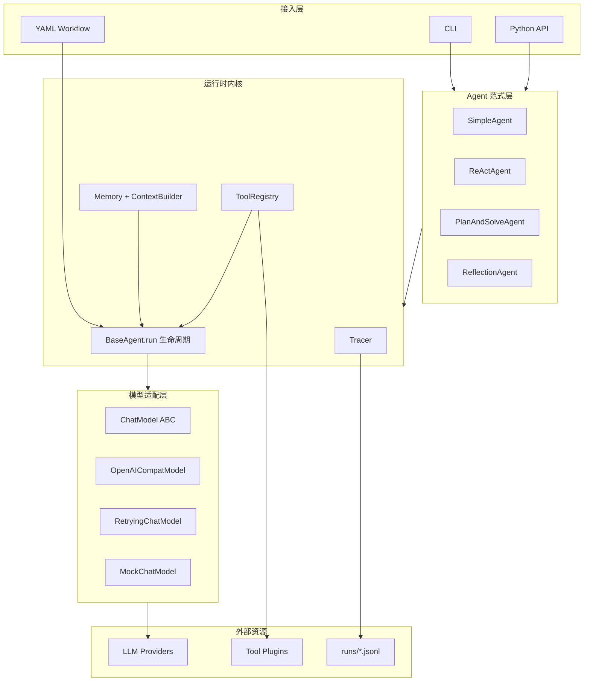
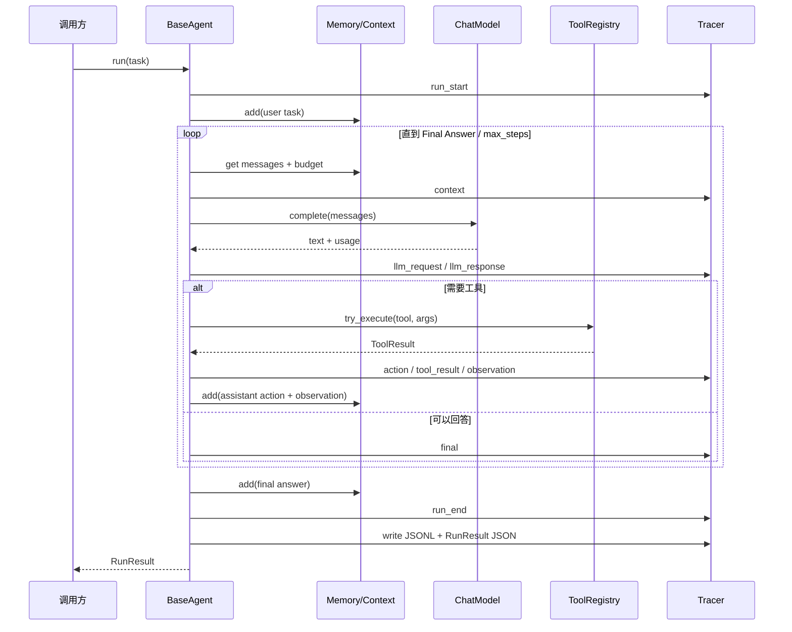

# HaloAgent v1.0 架构设计

> 目标：用第 1–7 章学到的知识，做一个**能读懂、能改、能扩展**的智能体框架，而不是再包一层黑盒。

## 1. 设计目标与非目标

### 目标

1. **小内核**：核心概念控制在 7 个以内，任何有 Python 基础的人能在半天内读完；
2. **统一入口**：所有范式都是 `agent.run(task) -> RunResult`；
3. **可替换模型**：换供应商只改配置，不改 Agent / Workflow；
4. **工具可插拔**：第三方工具不改框架源码即可加载/卸载；
5. **全链路可见**：每个结论都能追溯到 LLM 请求、工具参数、Observation 和耗时；
6. **低代码编排**：YAML 能表达"工具 -> 条件 -> Agent -> 输出"的常见工作流。

### 非目标

- 不做完整 RAG / MCP / 多 Agent 协作（第 8–10 章再扩展）；
- 不追求覆盖所有厂商 SDK，统一走 OpenAI 兼容协议；
- 不做可视化拖拽编辑器，只做 YAML DSL（可视化是它的前端）；
- 不把同步框架强行 async 化，避免教学时被事件循环干扰。

---

## 2. 分层视图



对应代码：

| 层 | 目录 | 关键类 |
|---|---|---|
| 接入 | `cli.py` / `workflow/` | `main`、`WorkflowEngine` |
| 范式 | `agents/` | `BaseAgent`、`ReActAgent`、`PlanAndSolveAgent`、`ReflectionAgent`、`SimpleAgent` |
| 运行时 | `agents/base.py`、`memory/`、`tools/`、`trace/` | `AgentOutcome`、`WindowMemory`、`ToolRegistry`、`Tracer` |
| 模型 | `models/` | `ChatModel`、`OpenAICompatModel`、`RetryingChatModel`、`MockChatModel` |
| 基础 | `core/` | `Message`、`AppConfig`、`RunResult`、异常体系 |

---

## 3. 一次 run 的完整生命周期



关键点：

- **Memory 只保存下一轮真正需要的内容**；完整思考过程在 Trace 里，不挤占上下文；
- **工具错误不会炸掉 Agent**：`try_execute()` 把错误变成 Observation，让模型有机会修正；
- **统一异常兜底**：`LLMError -> llm_error`、`AgentParseError -> parse_error`、其他异常 -> `error`；
- **Trace 先于结果**：即使运行失败，也会留下完整的失败现场。

---

## 4. 七个核心模块

### 4.1 Message（`core/message.py`）

- 内部字段：`role / content / name / tool_call_id / tool_calls / metadata / timestamp`；
- `to_openai()` 只输出协议需要的字段；
- 同时支持文本 ReAct 与原生 function calling 的扩展位。

### 4.2 Config（`core/config.py`）

- `LLMConfig / AgentConfig / MemoryConfig / TraceConfig / AppConfig`；
- 支持 YAML / JSON、`${ENV}` 与 `${ENV:-default}`、深层合并；
- 环境变量优先级最高，便于 CI / 部署；
- 读配置不创建网络客户端，方便单测。

### 4.3 ChatModel（`models/`）

```python
class ChatModel(ABC):
    def complete(messages, *, temperature, max_tokens, tools, **kwargs) -> ModelResponse: ...
    def stream(messages, *, ...) -> Iterator[StreamChunk]: ...
```

- `OpenAICompatModel`：关闭 SDK 自带重试，统一由框架控制；
- `RetryingChatModel`：只重试 `retryable=True` 的错误，指数退避 + jitter；
- `MockChatModel`：脚本/函数响应，单测与离线演示；
- `router.py`：provider 预设 + 环境变量自动检测。

### 4.4 Tool（`tools/`）

- `@tool` 从函数签名 + 类型注解 + docstring 生成 JSON Schema；
- `ToolSpec.invoke()` 做参数校验、类型转换、异常捕获、输出截断；
- `ToolRegistry` 负责注册、发现、调用、子集、插件加载/卸载；
- 插件支持 `TOOLS` / `@tool` / `register(registry)` 三种暴露方式，也支持 entry points。

### 4.5 Memory / Context（`memory/`）

- `WindowMemory`：按消息数与 token 预算保留最近对话；
- `SummaryMemory`：溢出时把旧消息压成摘要；
- `ContextBuilder`：系统提示 + 记忆 + 当前任务，按预算从旧到新裁剪，**永远保留最后一条用户消息**；
- 每次构建都发 `context` 事件，记录 `original / kept / dropped / estimated_tokens / budget`。

### 4.6 Agent（`agents/`）

- `BaseAgent.run()` 负责生命周期、异常、指标、Trace、落盘；
- 子类只实现 `_execute(task) -> AgentOutcome`；
- 三种范式共享 `_chat()` / `_tool()` / `_context()`，差异只在"如何组织思考步骤"。

### 4.7 Tracer（`trace/`）

- 事件：`run_start / context / llm_request / llm_response / thought / action / tool_result / observation / plan / step_result / reflection / revision / final / error / run_end`；
- 内存事件列表 + 实时 listener + JSONL；
- 默认脱敏 `api_key / authorization / token` 等字段；
- `RunResult.metadata.trace_events` 给出事件计数，便于快速体检。

---

## 5. 范式实现差异

| 范式 | 循环结构 | 终止条件 | 额外产物 |
|---|---|---|---|
| Simple | 一次 LLM 调用 | 返回即终止 | 无 |
| ReAct | Thought → Action → Observation | `Final Answer` 或 `max_steps` | thought/action/observation |
| Plan-and-Solve | 规划 → 逐步执行（可调工具）→ 综合 | 所有步骤完成 | `plan`、`step_result` |
| Reflection | ReAct 草稿 → 评审打分 → 修订 | 分数 ≥ 阈值或轮数上限 | `reflection`、`revision`、`final_score` |

**为什么 Reflection 继承 ReAct**：草稿阶段同样需要工具事实；继承后只重写 `_execute` 的"评审/修订"部分，避免复制工具循环。

---

## 6. 低代码工作流

### 6.1 节点类型

| 类型 | 必填字段 | 作用 |
|---|---|---|
| `tool` | `tool`, `args` | 调用注册表中的工具 |
| `agent` | `task`，可选 `paradigm/tools/max_steps` | 运行一个 Agent 范式 |
| `template` | `template` | 文本模板 / 提醒 |
| `condition` | `if` | 计算布尔值，供下游 `when` 使用 |
| `output` | `value` | 声明工作流最终输出 |

### 6.2 执行语义

1. `depends_on` 建 DAG，Kahn 拓扑排序；有环直接报错；
2. 节点 `when` 为假 -> `skipped`，下游引用其输出时得到空串；
3. 变量 `${inputs.x}` / `${nodes.id.output}` / `${env.X}`；整串匹配时保留原类型（数字/布尔/对象）；
4. 节点失败默认中止；`on_error: continue` 可继续并标记 `partial`；
5. 每个节点发 `workflow_node_start/end`，Agent 节点还有自己的子 Trace。

### 6.3 与第 5 章的关系

第 5 章的低代码平台把节点、连线、变量、条件封装成可视化画布。本项目把同一套语义收敛成 YAML：

```text
可视化画布  ->  YAML nodes + depends_on + when
平台变量    ->  ${inputs.x} / ${nodes.id.output}
平台试运行  ->  workflow_node_start/end + 子 Agent Trace
```

它不是要替代 Coze/Dify，而是证明"低代码编排的底层并不神秘"。

---

## 7. 关键设计取舍

### 7.1 文本协议而不是原生 function calling

- 优点：任何模型都能跑；Thought/Action 对学习者可见；Trace 可读；
- 缺点：格式不稳定，需要解析器与自我纠正；
- 折中：`ToolSpec.to_openai_schema()` 已生成标准 schema，后续可加 `FunctionCallAgent`。

### 7.2 同步而不是 async

- 优点：主循环、重试、Trace 都是线性代码，便于阅读与单测；
- 缺点：高并发场景需要外层线程/进程池；
- 工具中的 async 函数已支持（在独立线程中 `asyncio.run`）。

### 7.3 不引入 Pydantic

- 教材第 7 章用 Pydantic 做 Message/Config；本项目用 dataclass，减少依赖与学习成本；
- 参数校验由 `ToolSpec.validate()` 完成，错误信息更贴近工具场景。

### 7.4 Trace 与日志分离

- 日志是"给人看的字符串"；Trace 是"给程序和报告用的事件"；
- JSONL 一行一个事件，便于 `jq`、Notebook、Web 时间线消费；
- 报告生成器直接读 JSONL，不需要再解析自然语言日志。

### 7.5 插件按来源记账

- `_plugins[plugin_id] = [tool names]`；
- 卸载只删该插件注册的名字，不误伤同名工具；
- 同名冲突默认报错，显式 `replace=True` 才覆盖。

---

## 8. 扩展点

| 想扩展 | 怎么做 |
|---|---|
| 新模型供应商 | 在 `models/router.py` 加 `ProviderPreset`，或在配置里 `provider: custom` + `base_url` |
| 新 Agent 范式 | 继承 `BaseAgent`，实现 `_execute()`，注册进 `PARADIGMS` |
| 新工具 | 写函数 + `@tool`，`registry.register()` 或做成插件 |
| 新记忆策略 | 继承 `Memory`，实现 `add/messages/clear` |
| 新 Trace 消费者 | `tracer.add_listener(fn)`，或读 JSONL |
| 新工作流节点 | 在 `WorkflowEngine._run_node()` 加分支 + 校验 |
| 接 Web | 用 `on_event` 把 Trace 事件转 SSE；`RunResult` 直接 JSON 化 |

---

## 9. 失败模型

| 失败 | 状态 | 行为 |
|---|---|---|
| 模型 401/403/400 | `llm_error` | 不重试，快速失败 |
| 模型 429/5xx/超时 | `llm_error` | 指数退避重试，次数可配 |
| 输出不符合 ReAct 格式 | `parse_error` | 第一次给修复提示，第二次终止 |
| 工具参数错误 / 工具异常 | 继续循环 | 错误变成 Observation，模型可修正 |
| 达到 max_steps | `max_steps` | 返回无答案 + 最后输出，Trace 保留 |
| 工作流节点失败 | `error` / `partial` | 默认中止；可配 continue |

---

## 10. 质量门槛

- 22 个单元测试覆盖工具、记忆、模型重试、三种范式、工作流、配置、Trace 脱敏；
- 三范式对比与工作流 Demo 均可离线复现；
- 真实模型只需环境变量，不需要改代码；
- 所有运行产物在 `runs/`，报告在 `reports/`，不污染源码。
